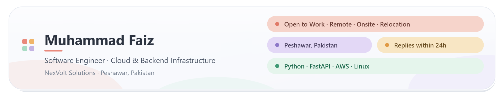
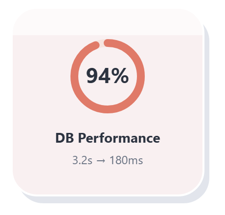
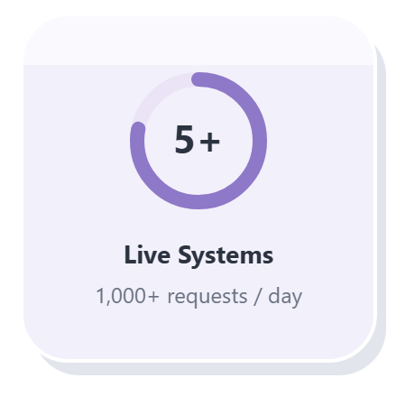
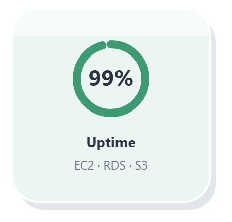
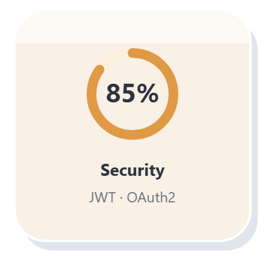
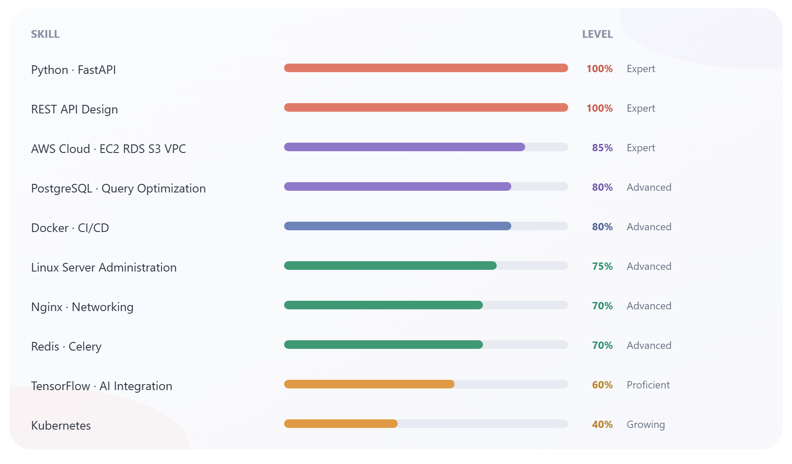

<div align="center">


<br/>



<br/>


<br/>

[](https://linkedin.com/in/muhammad-faiz-backend)
[](mailto:faizuet7@gmail.com)
[](https://github.com/faizuet)

<br/>

[](#about)
[](#impact)
[](#stack)
[](#experience)
[](#projects)
[](#contact)

</div>


<a id="about"></a>

## About Me

<table>
<tr>
<td valign="top" width="58%">

```yaml
Name      : Muhammad Faiz
Role      : Software Engineer · Cloud & Backend Infrastructure
Company   : NexVolt Solutions
Location  : Peshawar, Pakistan 🇵🇰
Available : Remote · Onsite · Relocation

Speciality: Python • FastAPI • AWS • Linux
Mission   : Helping businesses build reliable,
            scalable cloud-native systems

Currently :
  ├── ☁️  Building  → Cloud infra on AWS (EC2, RDS, S3, VPC)
  ├── 🎨 Building  → ImagifyAI (cloud-deployed image platform)
  ├── 🐳 Learning  → Kubernetes at scale
  └── 📐 Learning  → System Design for millions

Ask me about :
  ├── AWS · Docker · Nginx · Linux administration
  ├── FastAPI · PostgreSQL · Redis
  └── Making 3.2s queries run in 180ms ⚡
```

</td>
<td valign="middle" width="42%" align="center">

</td>
</tr>
</table>


<a id="impact"></a>

## Impact by the Numbers

<div align="center">

<table>
  <tr>
    <td align="center" width="25%">
      
    </td>
    <td align="center" width="25%">
      
    </td>
    <td align="center" width="25%">
      
    </td>
    <td align="center" width="25%">
      
    </td>
  </tr>
</table>

</div>


<a id="stack"></a>

## My Favorite Tools and Technologies

<div align="center">

<table>
  <tr>
    <td align="center" width="20%" bgcolor="#EDE4F8"><br/><br/><b>Python</b><br/><br/></td>
    <td align="center" width="20%" bgcolor="#E7DFF6"><br/><br/><b>FastAPI</b><br/><br/></td>
    <td align="center" width="20%" bgcolor="#EDE4F8"><br/><br/><b>Flask</b><br/><br/></td>
    <td align="center" width="20%" bgcolor="#E7DFF6"><br/><br/><b>PostgreSQL</b><br/><br/></td>
    <td align="center" width="20%" bgcolor="#EDE4F8"><br/><br/><b>Redis</b><br/><br/></td>
  </tr>
  <tr>
    <td align="center" bgcolor="#E3F6EC"><br/><br/><b>AWS</b><br/><br/></td>
    <td align="center" bgcolor="#DDF3E8"><br/><br/><b>Docker</b><br/><br/></td>
    <td align="center" bgcolor="#E3F6EC"><br/><br/><b>Linux</b><br/><br/></td>
    <td align="center" bgcolor="#DDF3E8"><br/><br/><b>Nginx</b><br/><br/></td>
    <td align="center" bgcolor="#E3F6EC"><br/><br/><b>Kubernetes</b><br/><br/></td>
  </tr>
  <tr>
    <td align="center" bgcolor="#F8E8E3"><br/><br/><b>MySQL</b><br/><br/></td>
    <td align="center" bgcolor="#FBF3EA"><br/><br/><b>Git</b><br/><br/></td>
    <td align="center" bgcolor="#F8E8E3"><br/><br/><b>GitHub</b><br/><br/></td>
    <td align="center" bgcolor="#FBF3EA"><br/><br/><b>TensorFlow</b><br/><br/></td>
    <td align="center" bgcolor="#F8E8E3"><br/><br/><b>GCP</b><br/><br/></td>
  </tr>
</table>

</div>

<br/>

<a id="skills"></a>

## Skill Depth

<div align="center">



</div>


<a id="experience"></a>

## Professional Journey

<br/>

<table width="100%">

<tr>
<td width="22%" valign="top" align="right">
<br/>

<br/><br/>
<sub>Remote</sub>
<br/>

</td>

<td width="3%" align="center" valign="top">
<br/>🟠<br/>│<br/>│<br/>│<br/>│<br/>│<br/>│<br/>│<br/>│<br/>│<br/>
</td>

<td width="75%" valign="top">
<br/>

### Go Jins — Python Backend Intern

Built RESTful APIs, implemented JWT authentication flows, and optimized SQL schemas for production workloads. First hands-on backend role working on real user-facing systems.

**Key contributions:**
- Developed backend services and REST APIs handling core business logic
- Implemented JWT auth and authorization middleware for secure API access
- Designed database schemas and wrote optimized SQL queries
- Integrated third-party APIs with proper validation and error handling


<br/>
</td>
</tr>

<tr>
<td width="22%" valign="top" align="right">
<br/>

<br/><br/>
<sub>Islamabad, PK</sub>
<br/>

</td>

<td width="3%" align="center" valign="top">
<br/>🟣<br/>│<br/>│<br/>│<br/>│<br/>│<br/>│<br/>│<br/>│<br/>│<br/>│<br/>
</td>

<td width="75%" valign="top">
<br/>

### Wanclouds Inc. — Backend Engineering Intern

Built production-grade microservices within an enterprise cloud company, gaining direct exposure to cloud-based product workflows. Ranked top performer for code quality and problem-solving throughout the internship.

**Key contributions:**
- Built production microservices with FastAPI and Flask
- Designed normalized MySQL schemas with Alembic migration scripts
- Implemented auth middleware, Pydantic validation, and structured error handling
- Built async background task queues with Celery + Redis for zero-blocking job processing


<br/>
</td>
</tr>

<tr>
<td width="22%" valign="top" align="right">
<br/>

<br/><br/>
<sub>Peshawar, PK</sub>
<br/>

</td>

<td width="3%" align="center" valign="top">
<br/>🟢<br/>│<br/>│<br/>│<br/>│<br/>│<br/>│<br/>│<br/>│<br/>│<br/>│<br/>│<br/>
</td>

<td width="75%" valign="top">
<br/>

### NexVolt Solutions — Backend Software Engineer

Owning full backend systems end-to-end — from cloud infrastructure to production API architecture. Deployed and manage systems on AWS, achieved a 94% database performance boost, and built automated deployment pipelines serving real users daily.

**Key contributions:**
- Deployed and maintained production applications on AWS (EC2, RDS, S3, VPC, CloudFront, Security Groups)
- Achieved **94% DB performance boost** — reduced query time from 3.2s to 180ms
- Automated deployments with Docker and CI/CD pipelines, cutting release time from hours to minutes
- Configured Nginx reverse proxy, SSL/TLS, DNS, and firewall rules for production services
- Monitored production servers, analyzed logs, and resolved infrastructure issues in Linux environments
- Hardened auth with JWT + OAuth2, reducing security vulnerabilities by **85%**
- Built Celery + Redis async queues for zero-blocking, zero-downtime background processing


<br/>

| What I Built | The Result |
|:-------------|:-----------|
| AWS deployment across EC2, RDS, S3, VPC, CloudFront | **99% uptime** in production |
| PostgreSQL query rewrite + indexing strategy | **94% faster** — 3.2s → **180ms** |
| Docker + CI/CD automated deployment pipeline | Deploy time cut from **hours to minutes** |
| Nginx reverse proxy + SSL/TLS + DNS configuration | Secure, reliable production traffic |
| JWT + OAuth2 authentication overhaul | **85% fewer** security incidents |
| Celery + Redis async background queues | Zero blocking · zero downtime |

<br/>
</td>
</tr>

</table>


<a id="projects"></a>

## Featured Projects

<br/>

<table width="100%">
<tr>
<td width="8" bgcolor="#EDE4F8"></td>
<td width="64%" valign="top">

### ImagifyAI — Cloud-Deployed Image Generation Platform

Enterprise-grade async image generation platform built for scale on AWS. Features zero-downtime deploys, multi-region CDN distribution via AWS CloudFront, background task processing with Celery, and branded email notifications via AWS SES.

**Key highlights:**
- Deployed on AWS (EC2, RDS, S3, CloudFront) with zero-downtime deployment strategy
- Multi-region CDN distribution — content served globally at edge
- JWT + OAuth2 auth with device and location-aware login alerts
- Scalable multi-tenant PostgreSQL schema with optimized indexing


</td>
<td width="34%" valign="top" align="center">
<br/>


<br/>

| Metric | Value |
|:-------|:------|
| Uptime | **99%** |
| Response | **< 150ms** |
| CDN | **Multi-Region** |
| Deploy | **Zero Downtime** |

<br/>

[](https://github.com/faizuet/genwalls)

</td>
</tr>
</table>

<br/>

<table width="100%">
<tr>
<td width="8" bgcolor="#E3F6EC"></td>
<td width="64%" valign="top">

### CarTrack API — Vehicle Tracking System

Optimized vehicle tracking backend with clean MVC architecture. Aggressive query tuning reduced response times by 60%. Fully containerized with Docker and Nginx reverse proxy with role-based access control.

**Key highlights:**
- Query optimization reduced response time from 5s → 2s (60% improvement)
- JWT authentication with refresh tokens and role-based access control (RBAC)
- Clean MVC architecture with separation of routes, services, and schemas
- Fully containerized with Docker Compose and Nginx reverse proxy


</td>
<td width="34%" valign="top" align="center">
<br/>


<br/>

| Metric | Value |
|:-------|:------|
| Performance | **60% Faster** |
| Query Time | **5s → 2s** |
| Auth | **JWT + RBAC** |
| Deploy | **Containerized** |

<br/>

[](https://github.com/faizuet/cartrack-api)

</td>
</tr>
</table>

<br/>

<table width="100%">
<tr>
<td width="8" bgcolor="#F8E8E3"></td>
<td width="64%" valign="top">

### Looks Lab — AI Personal Wellness Platform

Comprehensive wellness backend serving personalized AI insights across 8 domains: skincare, haircare, fitness, diet, and more. Features anonymous onboarding, multi-step session tracking, and full Stripe subscription management.

**Key highlights:**
- Google Gemini Flash integration for real-time AI wellness recommendations
- Anonymous onboarding with post-auth session linking — zero friction to start
- Google + Apple OAuth2 Sign-In with JWT refresh token auth
- Stripe subscriptions with monthly/yearly plans, trials, and webhook handling
- SQLAlchemy 2.0 async ORM with asyncpg for fully non-blocking DB operations


</td>
<td width="34%" valign="top" align="center">
<br/>


<br/>

| Metric | Value |
|:-------|:------|
| AI Domains | **8 Wellness** |
| AI Latency | **< 200ms** |
| Auth | **Google + Apple** |
| Payments | **Stripe** |

<br/>

[](https://github.com/faizuet/looks-lab-backend)

</td>
</tr>
</table>

<br/>

<table width="100%">
<tr>
<td width="8" bgcolor="#FBF3EA"></td>
<td width="64%" valign="top">

### LiverCare AI — Medical Image Classification

CNN-based pipeline for liver steatosis classification from ultrasound images. Preprocessed and augmented a dataset of 2,000+ medical images, then deployed the trained model as a real-time FastAPI inference endpoint.

**Key highlights:**
- CNN architecture tuned to achieve 87% classification accuracy
- 2,000+ medical images preprocessed and augmented for model generalization
- Real-time inference endpoint with sub-200ms response time
- Production API suitable for integration with clinical workflows


</td>
<td width="34%" valign="top" align="center">
<br/>


<br/>

| Metric | Value |
|:-------|:------|
| Accuracy | **87%** |
| Inference | **< 200ms** |
| Dataset | **2,000+ images** |
| Task | **Classification** |

<br/>

[](https://github.com/faizuet/livercare-ai)

</td>
</tr>
</table>


## GitHub Stats & Activity

<div align="center">

<a href="https://github.com/faizuet?tab=repositories">
  
</a>
<a href="https://github.com/faizuet?tab=repositories">
  
</a>

<br/>

<a href="https://github.com/faizuet?tab=stars">
  
</a>

<br/><br/>

<a href="https://github.com/faizuet">
  
</a>

</div>


## What People Say

<table>
  <tr>
    <td width="33%" valign="top" bgcolor="#F7F5F8">
      
      <br/><br/>
      <i>"Faiz delivered backend architecture faster than expected with zero compromise on quality. His query optimization work alone saved us significant infrastructure costs."</i>
      <br/><br/>
      <b>— Senior Engineer, NexVolt Solutions</b>
    </td>
    <td width="33%" valign="top" bgcolor="#F3F8F5">
      
      <br/><br/>
      <i>"One of the sharpest interns we've had. He picked up our microservices stack instantly and shipped features that went straight to production."</i>
      <br/><br/>
      <b>— Engineering Lead, Wanclouds Inc.</b>
    </td>
    <td width="33%" valign="top" bgcolor="#FBF6F4">
      
      <br/><br/>
      <i>"Faiz has a rare ability to think about the immediate implementation AND the long-term architecture simultaneously. Highly recommended."</i>
      <br/><br/>
      <b>— Tech Lead, Go Jins</b>
    </td>
  </tr>
</table>


## Fun Facts

```javascript
const faiz = {
  debugStyle  : "I read query execution plans, not guess 🔍",
  readingList : "System design case studies > novels 📖",
  origin      : "From Peshawar — one of Earth's oldest cities 🏛️",
  peakHours   : "Most productive at midnight when it's quiet 🌙",
  weeklyGoal  : "Ship at least ONE production feature every week 🎯",
  teamMotto   : "Great engineers make teammates better, not just code 🤝",
  hiddenTalent: "Can spot an N+1 query problem in seconds 👀",
};
```


## 2026 Growth Roadmap

<table width="100%">
<tr>
<th align="left" width="22%" bgcolor="#F7F5F8">Focus Area</th>
<th align="left" width="18%" bgcolor="#F7F5F8">Status</th>
<th align="left" width="33%" bgcolor="#F7F5F8">Goal</th>
<th align="left" width="27%" bgcolor="#F7F5F8">Progress</th>
</tr>
<tr>
<td><b>Kubernetes</b></td>
<td></td>
<td>Container orchestration at scale — deploy and manage multi-service apps in prod</td>
<td><code>████████░░░░░░░░░░░░</code> 40%</td>
</tr>
<tr>
<td><b>Virtualization & Cloud</b></td>
<td></td>
<td>Building deeper hands-on skills in virtualization, multi-cloud, and enterprise infrastructure</td>
<td><code>████████░░░░░░░░░░░░</code> 40%</td>
</tr>
<tr>
<td><b>System Design</b></td>
<td></td>
<td>Design distributed systems that handle millions of users without breaking</td>
<td><code>████████░░░░░░░░░░░░</code> 40%</td>
</tr>
<tr>
<td><b>Infrastructure as Code</b></td>
<td></td>
<td>Terraform-based provisioning for repeatable, version-controlled cloud infrastructure</td>
<td><code>████░░░░░░░░░░░░░░░░</code> 20%</td>
</tr>
<tr>
<td><b>Global SaaS</b></td>
<td></td>
<td>Ship a multi-region, multi-tenant SaaS product to a global audience</td>
<td><code>██░░░░░░░░░░░░░░░░░░</code> 10%</td>
</tr>
</table>


<a id="contact"></a>

## Let's Connect

<div align="center">

> *"I don't just write code — I engineer systems built to last, built to scale, and built to run in production."*

<br/>

*Available for backend and cloud engineering roles · infrastructure projects · high-performance systems · globally*

<br/>

<table>
<tr>
<td align="center" width="200" bgcolor="#F7F5F8">
  <a href="https://linkedin.com/in/muhammad-faiz-backend">
    
  </a>
  <br/><sub>Professional Network</sub>
</td>
<td align="center" width="200" bgcolor="#FBF6F4">
  <a href="mailto:faizuet7@gmail.com">
    
  </a>
  <br/><sub>Direct Email</sub>
</td>
<td align="center" width="200" bgcolor="#F3F8F5">
  <a href="https://github.com/faizuet">
    
  </a>
  <br/><sub>Open Source Work</sub>
</td>
</tr>
</table>

<br/>


&nbsp;


<br/><br/>


</div>
